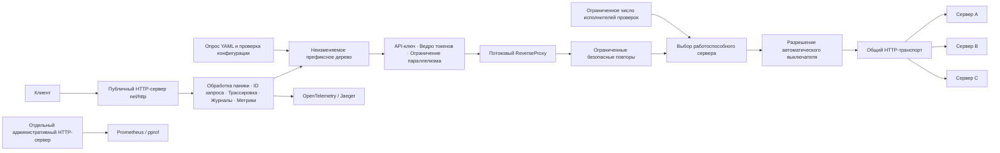

# Высокопроизводительный API-шлюз

Обратный прокси на Go, спроектированный с учётом требований эксплуатации: жизненного
цикла HTTP, конкурентного выполнения, ограничения ресурсов и восстановления после
сбоев. Балансировка нагрузки, алгоритм «ведро токенов», переходы состояния
работоспособности, повторные попытки, автоматические выключатели и снимки
конфигурации реализованы в самом проекте. `httputil.ReverseProxy` отвечает за
пересылку HTTP-сообщений и потоковую передачу. Маршрутизацией, допуском запросов,
выбором серверов и политикой отказоустойчивости управляет шлюз.

## Быстрый запуск

```sh
docker compose up --build -d
curl http://localhost:8080/api/users/fast
curl http://localhost:9091/admin/upstreams
docker compose run --rm k6
docker compose down
```

Порты на машине настраиваются через `.env` — скопируйте `.env.example`.
При проверке репозитория стандартные порты были заняты, поэтому использовались:
шлюз `18080`, административный интерфейс `19091`, серверы `18081..18083`,
Prometheus `19090`, Grafana `13000`, Jaeger `26686`. Локальный файл `.env`,
не отслеживаемый Git, содержит эти переопределения.

Адреса по умолчанию: [Grafana](http://localhost:3000/d/gateway-overview),
[Jaeger](http://localhost:16686), [Prometheus](http://localhost:9090).
Все порты демонстрационного окружения опубликованы только на петлевом интерфейсе.
Анонимный доступ к Grafana и `/control` у тестовых серверов предназначены для
локальной демонстрации.

Запуск без контейнеров с Go 1.26+:

```sh
go run ./cmd/mock-backend -address :8081 -id backend-a -delay 10ms
# В двух других терминалах: адреса :8082 / :8083, идентификаторы backend-b / backend-c.
go run ./cmd/gateway -config configs/gateway.yaml
```

## Возможности

- Поиск самого длинного префикса на границе сегмента через неизменяемое префиксное
  дерево. Сохраняются URL-кодирование путей, параметры запроса, удаление и замена
  префиксов, базовые пути целевых серверов.
- Циклическая балансировка, выбор по наименьшему числу активных запросов и случайный
  выбор. Неработоспособные серверы и серверы с недоступным автоматическим
  выключателем пропускаются. Время потоковой передачи входит в учёт активности.
- Активные проверки с порогами последовательных сбоев и успешных восстановительных
  проверок; пассивный учёт ошибок реальных запросов.
- Локальный алгоритм «ведро токенов» для маршрута или IP непосредственного клиента,
  ограниченное хранилище клиентов, очистка по TTL, ответ `429`, `Retry-After` и
  заголовки с оставшимся числом токенов.
- Аутентификация по API-ключу из переменной окружения (`X-Api-Key`), необязательное
  ограничение параллельных запросов на маршрут, ограничения тела и заголовков,
  общие предельные сроки выполнения и настраиваемый пул соединений.
- Ограниченные повторы безопасных методов с экспоненциальной задержкой, случайным
  разбросом и переключением на другой сервер. Автоматические выключатели
  CLOSED/OPEN/HALF_OPEN защищены от устаревших результатов через поколения состояния;
  число проверочных запросов в полуоткрытом состоянии ограничено.
- Строгая проверка YAML, опрос файла и атомарное обновление маршрутов. Состояние
  неизменённых маршрутов сохраняется, ошибочное обновление не заменяет последний
  корректный снимок.
- Журналы запросов в JSON, отдельный реестр Prometheus, передача контекста трассировки
  W3C, экспорт OTLP/HTTP, автоматически настроенная панель Grafana, закрытый pprof
  с явным включением и корректное завершение текущих запросов при остановке.

## Архитектура и жизненный цикл запроса



Каждый запрос использует один снимок конфигурации. Предельный срок маршрута охватывает
все попытки и потоковую передачу. Транспорт выбирает целевой сервер для каждой
попытки; тела отброшенных ответов с ошибками немедленно закрываются. Итоговое тело
передаётся потоком через буфер копирования размером 32 КиБ из пула.
Подробнее: [обработка запроса](docs/request-flow.md),
[конкурентность](docs/concurrency.md), [сеть](docs/networking.md).

## Конфигурация

```yaml
server:
  address: ":8080"
  adminAddress: "127.0.0.1:9091"
  readHeaderTimeout: 2s
  readTimeout: 10s
  writeTimeout: 15s
  idleTimeout: 60s
  shutdownTimeout: 30s
  maxHeaderBytes: 1048576
  maxBodyBytes: 10485760
routes:
  - id: users
    pathPrefix: /api/users
    stripPrefix: /api/users
    rewritePrefix: /users
    upstreams: [http://localhost:8081, http://localhost:8082]
    loadBalancer: least_connections
    timeout: 3s
    maxConcurrentRequests: 200
    retry: {enabled: true, maxAttempts: 2, backoff: 25ms, maxBodyBytes: 1048576}
    rateLimit: {requestsPerSecond: 100, burst: 50}
    circuitBreaker: {enabled: true, failureThreshold: 5, openDuration: 10s, halfOpenRequests: 2}
    # auth: {apiKeyEnv: USERS_API_KEY}
```

Все ограничения сервера и транспорта настраиваются в YAML. Переопределения через
переменные окружения: `HTTP_READ_HEADER_TIMEOUT`, `HTTP_READ_TIMEOUT`,
`HTTP_WRITE_TIMEOUT`, `HTTP_IDLE_TIMEOUT`, `SHUTDOWN_TIMEOUT`.
Полные примеры: [без контейнеров](configs/gateway.yaml), [Compose](configs/docker.yaml).

При горячем обновлении хеш содержимого проверяется каждые `reloadInterval`
(по умолчанию 1 с). Заменяйте файл атомарно. Обновляются только маршруты; изменения
сервера, транспорта, проверок работоспособности и трассировки требуют перезапуска.
Неизменённые маршруты сохраняют счётчики, токены и состояние выключателей;
изменённые начинают с нового состояния. Уже выполняющиеся запросы завершаются на
старом снимке. Ошибочные обновления попадают в журналы и метрики. Публичного HTTP API
для изменения конфигурации нет; работа не зависит от SIGHUP.

## Отказоустойчивость и обработка ошибок

Циклический алгоритм по очереди выбирает доступные серверы. Стратегия наименьшего
числа соединений сравнивает активные **запросы**, включая передачу тела, а не
TCP-сокеты. При равных значениях начальная точка обхода меняется, уменьшая перекос.
Работоспособность определяется активными проверками (по умолчанию `/health`,
интервал 5 с, таймаут 1 с, 3 сбоя / 2 успеха) и пассивными ошибками транспорта или
ответами 5xx. Ошибки 4xx не исключают сервер. Только активные проверки восстанавливают
работоспособность. До первых проверок серверы считаются работоспособными.

Повторы по умолчанию разрешены только для GET/HEAD/OPTIONS. Тела до
`retry.maxBodyBytes` можно воспроизвести; более крупные передаются потоком один раз.
`maxAttempts` включает первую попытку, максимум — 5. Повтор допустим для
502/503/504 и определённых сетевых ошибок до получения заголовков ответа. После
отправки байтов ответа клиенту повторов нет. Политика шлюза не повторяет небезопасные
методы. Стандартный транспорт Go может незаметно повторить запрос на устаревшем
соединении из пула по собственным консервативным правилам; входящий
`Idempotency-Key` сохраняет своё обычное значение для транспорта Go.

Автоматический выключатель считает последовательные ошибки транспорта и 5xx для
каждого сервера маршрута, открывается на заданное время, затем допускает ограниченное
число проверочных запросов в полуоткрытом состоянии. Проверки работоспособности и
выключатель — независимые условия допуска. Подробнее:
[повторы](docs/retries.md), [автоматический выключатель](docs/circuit-breaker.md),
[ограничение частоты](docs/rate-limiting.md), [балансировка](docs/load-balancing.md).

| Результат | Код ответа |
|---|---:|
| Маршрут не найден | 404 |
| Неверный API-ключ | 401 |
| Слишком большое тело | 413 |
| Недостаточно токенов | 429 |
| Ошибка транспорта | 502 |
| Нет доступного сервера / исчерпан параллелизм / идёт остановка | 503 |
| Истёк срок выполнения / сетевой таймаут до ответа | 504 |
| Клиент отменил запрос до ответа | 499 — условный код для журналов |

Ошибки шлюза возвращаются в JSON: `{code, message, requestId}`. Код и тело ответа
целевого сервера передаются клиенту. Сбой потока после заголовков прерывает
соединение: отправить второй ответ с JSON-ошибкой уже нельзя. Срок маршрута должен
быть меньше `writeTimeout` сервера. Для длительных потоков увеличьте ограничения
маршрута, чтения и записи; конечные ограничения демонстрации выбраны намеренно.

При SIGINT/SIGTERM шлюз перестаёт считаться готовым, прекращает принимать публичные
запросы, ждёт завершения текущих в пределах `shutdownTimeout`, отменяет и дожидается
фоновой работы, отправляет накопленные трассы и закрывает простаивающие соединения
к целевым серверам. Если срок ожидания истёк, обработчики отменяются, сокеты закрываются.

## Наблюдаемость и демонстрация сбоев

Административные адреса: `/health/live`, `/health/ready`, `/admin/routes`,
`/admin/upstreams`, `/metrics`, а при `profiling: true` — `/debug/pprof/`.
Для готовности нужен доступный сервер у **каждого** маршрута. Административные
обработчики не доступны через публичный HTTP-сервер.

Метрики используют настроенные идентификаторы маршрутов и серверов, нормализованные
методы и классы кодов ответа. Журналы содержат ID запроса, метод, URL-кодированный путь
без параметров, маршрут, код ответа, время выполнения, сервер, число повторов,
ошибку и IP непосредственного клиента. Authorization и API-ключи не записываются.
Трассировка создаёт интервалы выполнения — спаны — для входящего запроса, поиска
маршрута, ограничения частоты и попыток обращения к серверу; `traceparent` и
`tracestate` передаются тестовым серверам.

Подробнее: [наблюдаемость](docs/observability.md),
[границы доверия](docs/security.md), [сценарии сбоев](docs/failure-scenarios.md),
[архитектурные решения — ADR](docs/decisions/).

## Проверки и производительность

```sh
go test ./...
go vet ./...
go test -race ./...
golangci-lint run
go test -run '^$' -bench=. -benchmem ./...
go run ./cmd/experiment -duration 3s
go run ./cmd/loadtest -url http://localhost:8080/api/users/fast -concurrency 50 -duration 30s
docker compose run --rm -e SCENARIO=rate k6
```

Интеграционные тесты `httptest` проверяют реальное сетевое проксирование, переключение
при сбое, предельные сроки, работоспособность, заголовки, URL-кодированные пути,
ограничения частоты, тела и параллелизма, потоковую передачу, трассы W3C, отклонение
невалидного обновления, независимость снимка от входных данных и 1000 параллельных
запросов во время обновления. CI проверяет форматирование, vet, линтер, тесты,
отсутствие гонок данных, сборку Go и Docker.

Исходные результаты сохранены в [benchmark-results.txt](docs/benchmark-results.txt)
и [experiment-results.jsonl](docs/experiment-results.jsonl); разбор —
в [performance.md](docs/performance.md). Это локальные измерения. Они не определяют
пропускную способность развёрнутой системы. Сравнение включает CPU, создание
соединений и p50/p95/p99.

Локальные измерения на петлевом интерфейсе: Go 1.26.8, 32 исполнителя, 3 с;
клиент и серверы работают в общем процессе на рабочей машине с другой нагрузкой.

| Способ обращения | Запросов/с | p50, мс | p95, мс | Ошибки |
|---|---:|---:|---:|---:|
| Напрямую к серверу | 31934 | 0.205 | 4.740 | 0% |
| Через шлюз, соединения с серверами переиспользуются | 19167 | 0.680 | 5.869 | 0% |
| Через шлюз, переиспользование отключено | 9313 | 2.821 | 8.904 | 0% |

[Результаты проверок](docs/verification.md),
[снимок панели Grafana](docs/grafana-dashboard.png),
[реальная трасса Jaeger](docs/trace-example.json).

Профилирование:

```sh
go test ./internal/gateway -run '^$' -bench=BenchmarkProxyMiddlewareChain -cpuprofile=cpu.prof -memprofile=heap.prof
go tool pprof -top cpu.prof
go tool pprof -top heap.prof
# Работающий административный HTTP-сервер с включённым профилированием:
go tool pprof http://localhost:9091/debug/pprof/profile?seconds=30
curl 'http://localhost:9091/debug/pprof/goroutine?debug=1'
```

## Границы проекта и компромиссы

Проект демонстрирует ядро, спроектированное с учётом эксплуатации; он не является
полной заменой коммерческому шлюзу. Локальные ограничения частоты действуют отдельно
для каждого процесса. Аутентифицированная идентификация клиента, завершение TLS,
mTLS, взвешенная балансировка, Redis, отдельная поддержка WebSocket/gRPC, обнаружение
сервисов, кеширование и адаптивное ограничение параллелизма относятся ко второму
этапу. Буферы повторов и ответов не растут без ограничений; глобального мьютекса
обработки запросов нет. Утверждения об оптимизации требуют воспроизводимых измерений.
